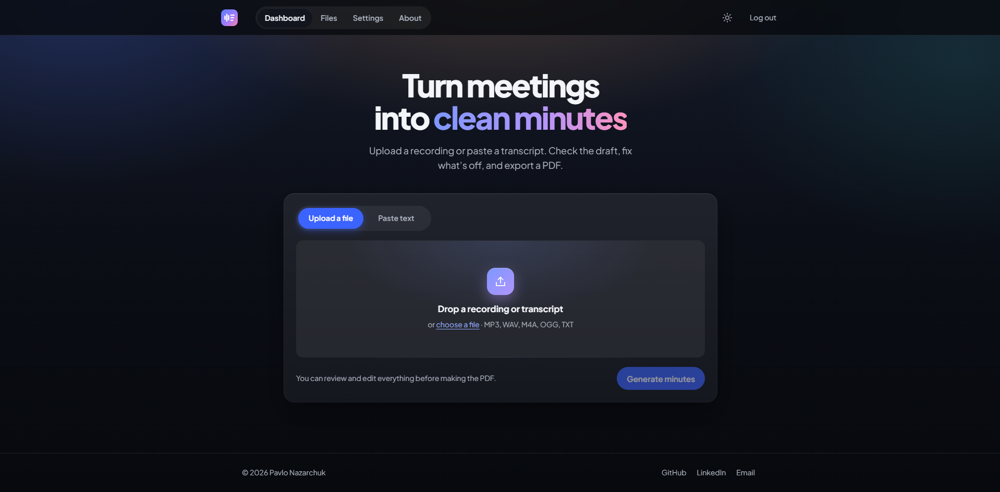

# 📝 Meeting Minutes Generator

A full-stack web application that converts meeting transcripts or audio recordings into structured meeting minutes. Upload your content, let AI process it, and download professionally formatted PDF minutes with an intuitive, mobile-responsive interface.

## 🌐 Live Demo

**Try it now:** [https://minutes.pavlonaz.com/](https://minutes.pavlonaz.com/)

Experience the app in action with a live deployment. Register for free and start generating professional meeting minutes instantly!

> ⚠️ **Security Notice:** This is a demo application. Please do not use real passwords or upload sensitive/confidential meeting content. Use test credentials and sample data only.

### Preview



---

## 🚀 Features

- ✅ **React frontend**: dark "dusk" theme with a light theme toggle, responsive from 375px phones to desktop
- ✅ **FastAPI backend**: Python API with JWT auth and bcrypt password hashing
- ✅ **MongoDB storage**: users, encrypted API keys, saved PDFs and usage stats
- ✅ **Audio or text input**: upload MP3, WAV, M4A, OGG or TXT, or paste a transcript
- ✅ **Free local transcription**: audio is transcribed on the server with [faster-whisper](https://github.com/SYSTRAN/faster-whisper), no API cost
- ✅ **Choice of AI for the minutes**: Groq (free tier) or OpenAI, using each user's own API key
- ✅ **Editable minutes**: review and fix the draft before anything is saved
- ✅ **Three PDF styles**: Professional, Minimal and Modern, with numbered sections, action item checkboxes and page numbers
- ✅ **Restyle saved PDFs**: switch a saved file to another style from the Files page
- ✅ **Personal files and usage stats**: every PDF is saved to your account

---

## 🔄 How It Works

1. **Add the meeting**: drop in a recording or transcript, or paste the text
2. **Generate**: audio is transcribed locally with Whisper, then your chosen AI provider structures it into minutes
3. **Review and edit**: fix the title, attendees, topics, decisions and action items
4. **Pick a style**: Professional, Minimal or Modern
5. **Download**: the PDF is saved to Files, where you can open it again or change its style

---

## 📋 Output Format

The AI structures meeting content into the following format:

```json
{
  "title": "Meeting Title",
  "date": "YYYY-MM-DD",
  "attendees": ["Name 1", "Name 2"],
  "summary": "Brief overview of the meeting",
  "discussion_points": [
    {
      "topic": "Topic name",
      "details": "Discussion details"
    }
  ],
  "action_items": [
    {
      "task": "Task description",
      "owner": "Person responsible",
      "due_date": "Due date"
    }
  ],
  "decisions": ["Decision 1", "Decision 2"],
  "next_steps": ["Step 1", "Step 2"]
}
```

---

## 🛠️ Tech Stack

| Layer           | Technology                                         |
|-----------------|----------------------------------------------------|
| Frontend        | React 19, React Router                             |
| Styling         | Plain CSS with design tokens, light/dark themes    |
| Backend         | FastAPI (Python 3.12)                              |
| Database        | MongoDB (Atlas or self-hosted)                     |
| Authentication  | bcrypt + JWT tokens                                |
| Transcription   | faster-whisper, runs locally (`small` model)       |
| Minutes         | Groq `openai/gpt-oss-120b` or OpenAI `gpt-4o-mini` |
| PDF generation  | ReportLab                                          |
| API key storage | Fernet encryption at rest                          |

---

## 📦 Installation

### Prerequisites

- Python 3.12 (3.15 is too new for some dependencies; the Docker image uses 3.11)
- Node.js 18+
- A MongoDB instance (MongoDB Atlas works)
- An API key from [Groq](https://console.groq.com/keys) (free) or [OpenAI](https://platform.openai.com/api-keys), added later in the app's Settings

No FFmpeg is needed: faster-whisper decodes audio itself. The first audio upload downloads the Whisper model (about 500 MB) to the Hugging Face cache.

### 1. Clone the repository

```bash
git clone https://github.com/PavloNa/meeting-minutes-generator.git
cd meeting-minutes-generator
```

### 2. Set up the backend

```bash
# Create virtual environment
python -m venv .venv
source .venv/bin/activate  # Windows: .venv\Scripts\activate

# Install dependencies
pip install -r requirements.txt
```

### 3. Set up the frontend

```bash
npm install
```

### 4. Configure environment variables

Copy `.env.example` to `.env` in the project root and fill it in:

```env
# MongoDB
MONGODB_CONNECTION=mongodb+srv://<user>:<password>@<cluster>.mongodb.net/?appName=<app>
MONGODB_DATABASE=minutes_generator_db

# Signs login tokens. Changing it logs everyone out.
JWT_SECRET=a-long-random-string

# Encrypts stored API keys. Changing it makes saved keys unreadable.
ENCRYPTION_KEY=another-long-random-string
SALT=a-unique-salt

# Where the React app finds the API
REACT_APP_API_BASE_URL=http://localhost:3001/api

# Optional
# GROQ_MODEL=openai/gpt-oss-120b   # Groq retires models often; override here
# WHISPER_MODEL=small              # tiny, base, small, medium, large-v3
# CORS_ORIGINS=https://your-domain.com
```

No global AI key goes in `.env`. Each user picks a provider and saves their own key on the **Settings** page.

---

## 🏃 Running the Application

### Option 1: Using Docker (Recommended)

The easiest way to run the application is using Docker Compose:

```bash
# Build and start all services
docker-compose up

# Or run in detached mode
docker-compose up -d
```

Access the application:
- **Frontend**: http://localhost:3000
- **Backend API**: http://localhost:3001
- **API Docs**: http://localhost:3001/docs

For detailed Docker instructions, see [DOCKER.md](DOCKER.md).

### Option 2: Manual Setup

#### Start the backend

```bash
cd backend
fastapi dev main.py --port 3001
```

On Windows the auto-reloader can keep serving old code after edits. If changes don't show up, stop it with Ctrl+C and start it again, or use `fastapi run main.py --port 3001`.

#### Start the frontend (from project root)

```bash
npm start
```

The frontend runs on `http://localhost:3000` and the backend on `http://localhost:3001`.

---

## 📡 API Endpoints

All routes are under `/api`. Interactive docs: http://localhost:3001/docs

### Authentication
| Method | Endpoint          | Description                                  |
|--------|-------------------|----------------------------------------------|
| GET    | `/`               | Root check                                   |
| POST   | `/create_user`    | Register a new user                          |
| POST   | `/login`          | Login and receive a JWT                      |
| POST   | `/verify_token`   | Check a JWT                                  |
| POST   | `/reset_password` | Stub: returns success but sends no email yet |

### User
| Method | Endpoint       | Description                       |
|--------|----------------|-----------------------------------|
| POST   | `/get_user`    | User details, AI config and usage |
| POST   | `/update_user` | Save AI provider and API key      |

### Minutes
| Method | Endpoint              | Description                                  |
|--------|-----------------------|----------------------------------------------|
| POST   | `/process_transcript` | Turn text or audio into structured minutes   |
| GET    | `/pdf_templates`      | List PDF styles                              |
| POST   | `/create_pdf`         | Build a PDF and save it to the user's files  |

### Files
| Method | Endpoint          | Description                          |
|--------|-------------------|--------------------------------------|
| POST   | `/get_user_files` | List saved PDFs (no file data)       |
| POST   | `/get_file`       | Get one PDF as base64                |
| POST   | `/restyle_file`   | Rebuild a saved PDF in another style |

---

## 📈 Progress

| Feature                          | Status         |
|----------------------------------|----------------|
| **Core Infrastructure**          |                |
| Project setup                    | ✅ Complete    |
| React frontend scaffolding       | ✅ Complete    |
| FastAPI backend setup            | ✅ Complete    |
| MongoDB integration              | ✅ Complete    |
| **Authentication**               |                |
| User registration                | ✅ Complete    |
| User login with bcrypt           | ✅ Complete    |
| JWT token authentication         | ✅ Complete    |
| Token verification endpoint      | ✅ Complete    |
| **UI/UX**                        |                |
| Responsive navigation bar        | ✅ Complete    |
| Mobile-first design (375px+)     | ✅ Complete    |
| Dark/light themes                | ✅ Complete    |
| **File Processing**              |                |
| Text transcript upload           | ✅ Complete    |
| Audio file upload (drag & drop)  | ✅ Complete    |
| Audio transcription (local Whisper) | ✅ Complete |
| Minutes generation (Groq/OpenAI) | ✅ Complete    |
| **Minutes Management**           |                |
| Editable minutes interface       | ✅ Complete    |
| Multiple PDF templates           | ✅ Complete    |
| PDF generation                   | ✅ Complete    |
| PDF preview in modal             | ✅ Complete    |
| Save/retrieve meeting files      | ✅ Complete    |
| **User Features**                |                |
| User profile page                | ✅ Complete    |
| AI provider configuration        | ✅ Complete    |
| Personal API key management      | ✅ Complete    |
| Files dashboard with statistics  | ✅ Complete    |
| Usage tracking                   | ✅ Complete    |
| **Future Enhancements**          |                |
| Groq provider (free tier)        | ✅ Complete    |
| More AI providers (Anthropic, Gemini) | 📋 Planned |
| Password reset (backend is a stub) | 📋 Planned   |
| Email notifications              | 📋 Planned     |
| Visual previews of PDF templates | ✅ Complete    |
| Improve templates                | ✅ Complete    |
| Restyle saved PDFs               | ✅ Complete    |
| Cyrillic/Unicode fonts in PDFs   | 📋 Planned     |
| Login/register forms             | ✅ Complete    |
| Better password requirements     | ✅ Complete    |
| Remove logo                      | ✅ Complete    |
| Add loading on '/'               | ✅ Complete    |
| Check if username exists         | 📋 Planned     |


---

## 🎨 UI/UX Highlights

- **Navigation**: logo, Dashboard, Files, Settings, About; collapses into a labelled menu on phones
- **Look**: dark "dusk" background with an electric-blue accent, plus a light theme toggle remembered per browser
- **Minutes view**: each section has its own color and number, matching the PDF layout
- **Motion**: short entrances and staggered sections, all respecting reduced-motion settings
- **Accessibility**: keyboard-friendly dialogs (Escape closes them), visible focus rings, WCAG AA contrast in both themes
- **States**: loading, empty and error states on every page

---

## 📄 Deployment commands for me
- Build frontend: git fetch && git pull && docker run --rm -v /home/pavlo/Hosting-Projects/Minutes-Generator:/app -w /app node:20-alpine sh -c "npm install && npm run build"
- Build backend: git fetch && git pull && docker-compose down && docker-compose build backend && docker-compose up -d
- Using CloudFlare tunnel (~/.cloudflared/config.yml)

## 📄 License

MIT License
